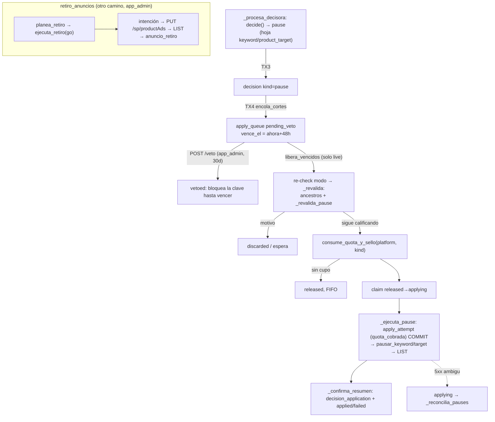

# AUTO-03 sobre el código actual: ciclo, cascada, cola, retiro y datos por producto

Base: HEAD `5adf1be0` (`resumen-ads-04-diseno`). En `app/` y `migrations/` es igual a `origin/master`
(`e6bab315`) salvo `app/meli/catalogo.py` y `0075_meli_sku_alias.sql` (comprobado con `git diff --stat
HEAD...origin/master -- app migrations`). Fusiona `01-ciclo-y-cascada.md`, `02-cola-retiro-autorizacion.md` y
`03-datos-producto-margen.md`, con las contradicciones revisadas contra el código.

## Overview

El ciclo del optimizador (`app/cycle.py`, `corre_ciclo`) decide sobre **hojas** (keyword y product_target) y
sobre **ad groups** (cortes por search term). Nunca recorre product ads. Por hoja resuelve un goal (campaña
antes que plataforma), calcula un target ACoS con una cascada de cinco peldaños (`app/optimizer/goals.py`), lo
congela en `target_acos_ciclo` y en `decision.inputs`, y llama a la política pura `niveles_v3`
(`politica.decide`). Las pausas, negatives y harvests pasan por una sola cola (`app/apply_cola.py`): 48 h de
veto, revalidación con datos frescos, cuota diaria, claim, HTTP y registro en el ledger. Hoy esa cola solo
sabe ejecutar pausas de keyword o product_target.

Las pausas de **product ads** van por otro camino, `app/retiro_anuncios.py`, que corre como `app_admin` fuera
del ciclo. Lo usan dos llamadores: la UI de la fábrica (manual, con confirmación tecleada) y el vigía de
impulso. Las métricas Ads por producto viven aparte de las de hojas (`ads_product_metric_observation`, grano
ASIN+SKU+fecha, sumado sobre campañas y ad groups) y el margen individual vive en `v_margen_producto`. El
ciclo no lee ninguna de las dos. En resumen, AUTO-03 tiene que conectar tres subsistemas que hoy no se hablan:
ciclo/cascada, cola y retiro, y datos por producto.

## Conceptos clave

- **`Goal`** (`goals.py:141`): espejo de `ads_optimizer_goal`, con `scope` campaign o platform,
  `target_acos_pct` (puede ser None), `enabled` y `mode` (off/shadow/live). `resuelve_goal` (`:178`) devuelve
  el de campaña si existe, **aunque esté deshabilitado**; si no, el de plataforma. Sin goal resuelto y
  habilitado, la hoja no entra (`sin_goal`/`goal_disabled`/`goal_mode_off`).
- **Peldaños** (`PELDANOS_CASCADA`, `goals.py:270`): `goal_campana`, `goal_plataforma`, `margen_familia`,
  `margen_plataforma`, `setting_plataforma`. El orden único vive en `_nucleo_target_acos` (`:279-303`). Un
  peldaño None cae al siguiente; un valor ≤0 o no finito lanza excepción en vez de caer. Un goal con target
  None "no decide" y deja pasar los peldaños de margen.
- **`target_acos_ciclo`**: una fila por (ciclo, hoja) con `target_acos_pct` y `procedencia`, protegida por un
  CHECK con los cinco nombres (`0063_bids02_peldanos_target.sql:22-27`, que redefine el de 0048). Es el ancla
  del paso de familia y la fuente de /campanas.
- **`optimizer_cycle.notes.target`**: snapshot del peldaño de plataforma (`target_aplicado`, margen neto). Es
  el ancla del paso de plataforma y la fuente de `equilibrio_acos_pct`.
- **`decision`** (`0001:846-976`): append-only, `kind decision_kind` (bid, budget, pause, resume, negative,
  harvest; ninguna migración lo amplía), `inputs JSONB` con todo lo necesario para el replay, sin FK a ninguna
  evaluación.
- **`apply_queue`** (`0002:55-110`): solo pause/negative/harvest (`apply_queue_solo_cortes`). `familia`
  GENERATED (pause → `entity_cut`, resto → `term_cut`). Clave de efecto `(platform, ad_entity_id, familia,
  search_term)` única entre filas no terminales.
- **`anuncio_retiro` / `anuncio_retiro_intencion` / `anuncio_reposicion`** (0066, 0069): ledger propio del
  retiro, append-only, con un retiro abierto por anuncio y una intención pendiente por anuncio. Sin
  `decision_id`. `motivo` restringido a `impulso|sin_pedidos|subfamilia`.
- **Identidad**: `product` (`odoo_sku`) ← `listing` (único por `(platform, external_id=ASIN)`, un solo
  `seller_sku`) ← `ad_entity` kind `product_ad` con `listing_id`, vinculado **solo por ASIN**
  (`app/ads/structure.py:427-436`). `ad_entity` no guarda SKU.
- **Precedente a imitar**: `propuestas_campana.lee_evaluaciones` en TX2 y `guarda_evaluaciones` en TX3, detrás
  del flag `ads_propuestas_campana` (tabla `ads_campaign_proposal`). Es el patrón "evaluar en el snapshot,
  persistir con las decisiones" que propone la spec.

## Cómo funciona

### El ciclo: TX1..TX4

`app/cli.py` corre el ciclo como `ORBIT_DSN_DECIDE` (rol `app_decide`). `corre_ciclo` (`cycle.py:2995`) abre
**TX1**: claim del ciclo y envelope.

**TX2** es `_fase_lecturas` (`:2421-2458`): REPEATABLE READ, sin escrituras. Guarda la ventana de plataforma,
lee `apply_cola.claves_bloqueadas` (claves con fila en vuelo o veto vigente) y llama a `_recorre_plataforma`
(`:2296-2418`). Esa función lee todo una sola vez por plataforma: `g.target_desde_settings`, el peldaño de
plataforma (`_resuelve_target_ciclo`, `:2011-2108`), las familias (`_lee_familias_ciclo`), los goals, las
evidencias por ad group, los inertes, la `politica` y, con el flag, las evaluaciones de `propuestas_campana`.
Con eso arma `lecturas = lee_plataforma(...)` y el dict `comunes`. Después recorre:

- hojas: `for fila in _SQL_DECISORAS` → `_procesa_decisora` (`:1617`);
- ad groups: `for fila in _SQL_GRUPOS` → `_procesa_grupo` (`:1834`).

Los product ads solo aparecen en `_SQL_PAREJAS_CAMPANA_FAMILIA` (`:503-514`), que colapsa product_ad → listing
→ product → familia **por campaña**.

Dentro de `_procesa_decisora`, después de los gates (estado, goal, veto pendiente, inertes) viene el target
(`:1706-1728`):

```python
target_margen_familia, snapshot_fam = _margen_familia_de_hoja(familias_ciclo, campaign_id, entidad_id)
target = g.cascada_target_acos(goal.target_acos_pct, setting_target, margen_plataforma, goal.scope, target_margen_familia)
procedencia = g.peldano_target_acos(goal.target_acos_pct, goal.scope, margen_plataforma, setting_target, target_margen_familia)
contadores.targets[entidad_id] = (target, procedencia)
```

El motor **no** usa `cascada_target_acos_con_procedencia`. Pasa un goal ya resuelto y llama dos funciones con
órdenes posicionales distintos. Con `target is None` la hoja se salta con `sin_target`. `_procesa_grupo` hace
lo mismo (`:1895-1915`) pero no escribe en `contadores.targets`: solo las hojas se congelan en
`target_acos_ciclo`.

Luego `lecturas.caso(..., target_acos_pct=target, pausa=InsumosPausa(...))` arma un `CasoHoja` y
`decide(caso)` (`politica.py:130-254`) devuelve el veredicto. R0 pausa por clics/costo o por exceso económico
(`cost - target×revenue/100`), R3 compara contra `equilibrio_acos_pct` y R4–R6 usan target × 1.15/1.35/0.85.
Ojo: `equilibrio_acos_pct` sale del margen de **plataforma** (`cycle.py:2378`) y es igual para todas las
hojas.

**TX3** es `_corre_fases` (`:2852-2866`), en READ COMMITTED: `_inserta_decisiones` (executemany de
`_Pendiente`), `_inserta_targets`, `guarda_evaluaciones` (con el flag) y `_cierra_envelope`. **TX4** es
`_fase_apply` (`:2552`): `encola_cortes` y, solo en live, `libera_vencidos`, todavía como `app_decide`.

### El paso asimétrico del margen

`resuelve_target_margen` (`goals.py:880-932`) calcula `fraccion × margen_neto`, lo recorta a [10,45] y, si hay
ancla, sube de una vez o baja como máximo 0.5 por ciclo. Con dato inválido (`_motivo_dato_invalido`:
sin_margen, cobertura_baja, ventana_corta, ledger_rancio) converge 0.5 por ciclo hacia el setting
(`_converge_al_destino`); sin ancla devuelve None y el peldaño cae. El ancla **no** sale de un cache:

- plataforma: `notes.target.target_aplicado` del último ciclo live+done con procedencia `margen_plataforma`
  (`_SQL_NOTAS_PREVIAS`, `cycle.py:562-569`);
- familia: `target_acos_ciclo` previo de la hoja (`_SQL_TARGETS_PREVIOS`, `:524-533`), con `tiene_previo` solo
  si el previo fue `margen_familia`.

El argumento `cache_acos_target` de `_con_procedencia` está muerto: se valida y no se usa
(`goals.py:360-364`). La fracción viene de `ads_target_fraccion_margen_<plat>` (`fraccion_desde_settings`,
`:659`); ausente equivale a interruptor apagado (`sin_fraccion`).

### Freeze y replay

`pendiente_bid` (`cycle.py:859-933`) congela en `inputs`: `politica:"niveles_v3"`, el `caso` completo (con
`economia.target_acos_pct` y `equilibrio_acos_pct`), `target_acos_pct_usado`, `target_procedencia`,
`target_snapshot` (si ganó un margen), `goal` y `corte`. `replay.reproduce(inputs)`
(`app/optimizer/replay.py:122-148`) reconstruye `CasoHoja.desde_json(inputs["caso"])` y vuelve a llamar
`decide`. **Nunca recalcula la cascada.** Por eso un peldaño nuevo no rompe el replay de bids mientras el
target siga congelado en el caso. Freeze y replay están partidos a propósito: cada clave nueva va en los dos
lados (`replay.py:12-16`).

### Una PAUSE hoy: de la decisión al ledger



Detalles que importan:

- `encola_cortes` (`apply_cola.py:478`) lee `decision` con `kind IN ('pause','negative','harvest')`
  (`_SQL_CORTES_CICLO`, `:148`). El payload de pausa solo existe para hojas (`{keywordId|targetId, state}`);
  cualquier otra entidad recibe `{}`. El modo se re-resuelve por decisión en `_modo_efectivo_corte`
  (`:422-451`): hojas → `Aplicador.modo_efectivo`, cualquier otra cosa → `_SQL_GRUPO_VIVO`, que filtra
  `kind='ad_group'`. **Un product_ad cae a shadow.**
- El ciclo salta la hoja **entera** (no solo el pause) si su clave está bloqueada (`MOTIVO_VETO_PENDIENTE`,
  `cycle.py:1675-1683`). La clave es por `ad_entity_id`.
- `_revalida` (`:901-925`) despacha por `fila.kind`: pause → `_revalida_pause`, negative →
  `_revalida_negative`, **cualquier otro → harvest**. `libera_vencidos` ejecuta `_ejecuta_pause` si es pause y
  **cualquier otro kind como negative** (`:1215-1219`).
- `_revalida_pause` (`:726-844`) exige que la identidad esté en `apply._KINDS_DECISORAS` (keyword,
  product_target); si no, devuelve `entidad_no_viva`. Recalcula el target con `_target_pause_vigente`
  (`:618-664`) vía `_con_procedencia` **sin familia**, lee estado fresco por LIST y re-decide con
  `bid.decide_pause`.
- La cuota se cobra por `fila.kind` contra `ads_apply_cap_<p>_<kind>` (`KINDS_QUOTA` en `apply.py:307`, mapa
  SQL en `0039_precio.sql:1150-1162`). Un kind sin mapear no cobra y queda sin cupo (fail-closed).
- `_ejecuta_pause` commitea el `apply_attempt` antes del HTTP. El cliente de escritura llega del Aplicador:
  `apply_cola` no importa `app.ads.write`, que tiene candado de imports
  (`tests/test_architecture.py:321-345`).
- La reversa manual (`POST /reversa/pause` → `apply_cola.reversa_pause`) escribe un `apply_attempt` tipo
  `reversa` sin cobrar cuota.

### `retiro_anuncios`: cómo pausa y repone product ads

`planea_retiro(conn, plataforma, *, listing_ids, motivo, conservar_grupo_id)` (`:116-143`) elige product ads
ENABLED (o con intención abierta) de esos listings, fuera del grupo a conservar y **fuera de ad groups con
impulso abierto** (`:64-87`). Produce un `PlanRetiro` con huella sha256.

`ejecuta_retiro(conn, plan, *, go: str, impulso_id=None, escritor=None, actor=None) -> int` (`:265-343`)
valida solo que `go` no esté vacío. Toma advisory locks de sesión `retiro-ad:<id>`, hace una lectura global
previa y, por anuncio, registra la intención → `PUT /sp/productAds` vía `app.ads.archivar` → readback.
`pausado` o `ya_estaba` sellan `anuncio_retiro` con la reversa; `sin_confirmar` deja la intención abierta. Si
algo falla lanza `RuntimeError` con un conteo en el texto: no hay resultado por anuncio.

`repone(conn, *, retiro_ids, go, ...)` (`:423-488`) reactiva el mismo adId y, **si lo lee ARCHIVED, lo recrea
en silencio** con `POST /sp/productAds` (`:513-518`). `reconcilia_intenciones` (`:534-646`) sella el retiro
cuando lee PAUSED, usando la reversa guardada antes del PUT.

Llamadores, todos como `app_admin`:

- UI de la fábrica: `POST /retiro/ejecutar` (`go = "SACAR {n} ANUNCIOS"` tecleado y check de huella) y
  `/retiro/reponer` (`app/api_fabrica.py:684-745`).
- Vigía de impulso (`app/impulso_io.py:1034-1057`, CLI `impulso-vigia`): con la primera impresión retira los
  anuncios del producto en otras bolsas con `go = impulso.go_literal`, el literal humano guardado al lanzar el
  impulso.

Ningún camino automático del ciclo pausa un product ad hoy.

### Datos por producto

- **Métricas** (`0020_ads_producto_metrica.sql`): reporte `spAdvertisedProduct` (`reports.py:369-401`), sumado
  por `(asin, sku, fecha)` sobre todas las campañas y ad groups (`_planea_filas_productos`, `:1148-1160`).
  Columnas útiles: clicks, cost, purchases30d, sales30d, `purchases_same_sku30d`,
  `attributed_sales_same_sku_30d`, `campaign_ids`/`ad_ids` JSONB ("JAMAS insumo para repartir"). El gzip solo
  trae filas con actividad: ASIN ausente = sin dato. No hay vista de colapso ni `as_of`; cada lector repite
  `DISTINCT ON (asin, sku, metric_date) ORDER BY observed_at DESC`. La ingesta diaria reobserva D-31..D-1,
  tres veces al día. Datos desde 2026-08-08.
- **Madurez y suma**: ya existen en `app/evaluacion_catalogo.py`. `_fecha_madura` (`observed_at >= metric_date + 30d`,
  `:125-131`), suma con veneno (None contagia) y `halo30d = sales30d - same_sku`. `evaluar_ads` cuenta
  muestra, pero no exige todas las fechas del intervalo.
- **Margen**: `v_margen_producto` (`0018:283-436`) con ventana `[2026-02-20, now()-15)`, sin ads, NULL si la
  cobertura es menor a 0.95, si hay menos de 30 días con venta o si hay mezcla de monedas o cargos sin tipo.
  `ledger_fresco_at` es **global**. La frescura de 3 días la aplica solo `goals._motivo_dato_invalido`.
  `v_economia_producto` (0021) agrega una muestra limitada "solo UI, jamas target". `app_decide` ya tiene
  SELECT sobre ambas vistas y sobre la tabla de métricas.
- **Pisos de PAUSE** (de hoja): `umbral_corte` adaptativo por ad group, `max(100, ceil(clics/orders×1.5))`
  (`cortes.py:118-140`); costo 500 MXN / 40 USD (`bid.py:109-111`); `_decide_pause` exige agregado `completa`
  (≥7 fechas).
- **Pantalla** `/productos-sin-clics` (`app/pantalla_productos.py`): solo SELECT, sin margen, gasto, ACoS ni
  stock. No tiene ficha en `.cursor/skills/verify-orbit/features/`.
- **Stock**: `disponibilidad_observation` se llena con una copia manual del snapshot del bridge. La tabla de
  SP-API se declara "no fuente". No hay cadencia.

## Dónde vive cada cosa

| Pieza | Archivo |
|---|---|
| Orquestación TX1..TX4, recorridos, freeze | `app/cycle.py` (3032 líneas) |
| Goal, cascada, margen, fracción | `app/optimizer/goals.py` (1051) |
| Política pura y pausa | `app/optimizer/politica.py`, `bid.py`, `cortes.py`, `caso.py` |
| Replay | `app/optimizer/replay.py`, `tools/rejuega_niveles.py`, `tools/replay_ads_economico.py` |
| Cola, veto en ciclo, revalidación, cuota | `app/apply_cola.py` (1345), `app/apply.py`, `app/apply_harvest_reconciliacion.py` |
| Veto y reversa HTTP | `app/api_write.py` |
| Retiro y reposición de product ads | `app/retiro_anuncios.py`, `app/ads/archivar.py`, `app/api_fabrica.py`, `app/impulso_io.py` |
| Precedente de evaluación por lote | `app/propuestas_campana.py` |
| Margen y métricas por producto | `migrations/0018`, `0020`, `0021`; `app/economia_observada.py`, `app/evaluacion_catalogo.py` |
| Etiquetas de peldaño | `app/api_dashboard.py` (`PISA_POR_PELDANO`), `app/ui.py` |
| Siguiente migración libre | `0076` (sobre `origin/master`; HEAD local no tiene 0075) |

## Gotchas: restricciones duras que el código impone a la spec AUTO-03

1. **La llamada de la spec no es la del motor.** La spec escribe
   `cascada_target_acos_con_procedencia(goal_campana, goal_plataforma, settings, cache_acos_target, ...)`. El
   motor usa `cascada_target_acos` + `peldano_target_acos` con un goal ya resuelto (`cycle.py:1709,1722`).
   *Plan:* agregar `target_margen_producto` como keyword-only a las tres variantes y a `_nucleo_target_acos`,
   sin migrar el motor a `_con_procedencia`. Corregir el snippet de la spec y no citar `cache_acos_target`,
   que está muerto.
2. **Un peldaño nuevo implica migración y seis puntos de paridad.** CHECK
   `target_acos_ciclo_procedencia_check` (0063), `PELDANOS_CASCADA`, `PISA_POR_PELDANO` (lanza KeyError ante
   un nombre nuevo), validación 422 de `ui.py`, `_FUENTES_COMPARTIDAS` de `replay_ads_economico.py` (que ya
   omite margen_familia) y el test estático de paridad. *Plan:* una migración, más el ajuste de todos esos
   puntos en el mismo PR.
3. **"Goal explícito gana" casi anula el peldaño en la práctica.** [decisión del dueño] Gana cualquier goal
   **con target no nulo**. Las campañas de la fábrica y del impulso nacen con un goal de campaña cuyo target
   ya sale del margen, recortado a [10,45] (`fabrica_plan.target_del_grupo`, `:326-345`;
   `tools/fabrica_campanas.py:1299-1308`), y el impulso lo conserva al graduarse (`edita_goal(mode="live")`).
   El peldaño de producto solo aplicaría donde el goal resuelto tenga target None. *Plan:* correr antes el
   SELECT de cuántos goals vivos tienen target. El dueño decide si los goals de fábrica cuentan como
   "explícitos" o si se les quita el target. La frase de la spec "al graduarse entra por la misma evaluación"
   es falsa con el código actual.
4. **El piso de 10 está cableado.** `resuelve_target_margen` recorta a [10,45] y `_converge_al_destino`
   recorta el ancla a la misma banda. *Plan:* una función nueva que reutilice solo `fraccion_desde_settings`,
   `MARGEN_BANDA_MAX` y `_motivo_dato_invalido(dias_min=30)`, sin llamar a `resuelve_target_margen`. El caso
   8% × 0.5 → 4% lo prueba.
5. **No hay ancla ni paso para producto.** [decisión del dueño] La spec no dice si el peldaño sube de una vez
   y baja 0.5, ni qué pasa cuando el producto se abstiene. Hoy, si el producto deja de medir, el target
   saltaría a familia o plataforma en un solo ciclo, justo lo que `_converge_al_destino` evita en los otros
   peldaños. *Elegir:* (a) sin paso, o (b) ancla = `target_acos_ciclo` previo con procedencia
   `margen_producto`, con el mismo `PASO_POLITICA` y su congelado en notes.
6. **R3 compara contra el equilibrio de plataforma** (`cycle.py:2378`), aunque gane el producto. *Elegir:*
   aceptarlo y declararlo, o pasar un equilibrio por hoja (cambia `EconomiaPlataforma`/`Economia`, el freeze
   del `caso` y el replay).
7. **El ciclo no conoce "ad group exclusivo".** Hoy la única topología de product ads que lee es campaña →
   familia (`_SQL_PAREJAS_CAMPANA_FAMILIA`, por campaña). *Plan:* una lectura nueva en TX2: product ads no
   archivados por ad group (incluye PAUSED) → `listing_id` → `product_id`. Exclusivo = todos con listing y el
   mismo producto. Un `listing_id` NULL lo vuelve no exclusivo. La cascada queda con dos granos: familia por
   campaña y producto por ad group.
8. **No hay métrica por anuncio ni por ad group de producto.** La tabla suma todas las campañas y ad groups
   del `(asin, sku, fecha)`. "Pausar solo los product ads que contribuyeron" no tiene dato, salvo `ad_ids`
   JSONB, que el schema declara "JAMAS insumo para repartir". [decisión del dueño] *Elegir:* usar `ad_ids`
   solo como pertenencia (no reparto), o definir el alcance como "todos los product ads ENABLED del producto
   con identidad comprobada".
9. **El SKU del anuncio no existe en Orbit.** `ad_entity` no tiene SKU y `listing` es único por ASIN con un
   solo `seller_sku`, pero el reporte trae `(asin, sku)` y puede traer varios SKU por ASIN. *Elegir:* ligar
   fila → producto solo por ASIN (como la pantalla, `pantalla_productos.py:212-218`) o exigir `sku =
   listing.seller_sku` y abstenerse si no coincide. Ojo: "mismo SKU" en `purchases_same_sku30d` se refiere al
   SKU anunciado de esa fila.
10. **"Fecha ausente = desconocido" excluye justo a los candidatos a pausa.** [decisión del dueño] El reporte
    SP omite las fechas sin actividad (comentario de 0020). Un producto con gasto y cero ventas casi siempre
    tiene días sin impresiones, así que con la regla de la spec ("valores explícitos para todas las fechas")
    nunca estaría completo y nunca se pausaría. *Plan:* el dueño decide si una fecha sin fila, dentro de un
    rango cubierto por un reporte COMPLETED de una run ok, cuenta como cero, o si se acepta cobertura casi
    nula. Medirlo con SELECT antes de construir.
11. **Madurez +30 frente al periodo de las hojas.** La spec exige que identidad y ausencia de halo cubran el
    periodo de evidencia de las hojas: bids 30 días que terminan en `max(metric_date)-3`
    (`windows.py:131-132`), cortes `D-90..D-10` (`:140-142`). Las fechas con menos de 30 días nunca son
    maduras. Exigir madurez ahí vuelve el peldaño inalcanzable siempre, no solo hoy. Además, la ingesta solo
    reobserva hasta D-31: cada fecha tiene dos runs (X+30, X+31) para madurar y, si el cron falla esos días,
    no madura nunca. *La spec debe corregirse:* qué madurez se pide para el tramo reciente del halo, o aceptar
    halo no maduro con motivo.
12. **No hay colapso ni `as_of` para métricas de producto.** El replay de la evaluación no puede reconsultar,
    porque la tabla crece y `v_margen_producto` usa `now()`. *Plan:* congelar en `evaluacion_producto_ciclo`
    los valores colapsados y el margen (la spec ya lo propone). Reutilizar `_fecha_madura` y la suma con
    veneno de `evaluacion_catalogo` en vez de reescribirlos.
13. **Los pisos de PAUSE son de hoja.** [decisión del dueño, la spec ya lo marca] `umbral_corte` es adaptativo
    por ad group (≥100) y `_decide_pause` exige `completa` con evidencia de hojas (`v_metric_latest`), no del
    reporte de producto. *Plan:* usar `F_PAUSE` (100) fijo y `PAUSE_COST_MIN` importados de su fuente, y
    declarar que no se usa el adaptativo.
14. **Kind nuevo `pause_product_ad` o `pause` sobre entidad `product_ad`.** (A) Con kind nuevo hay que tocar: enum
    `decision_kind`, `decision_termino_coherente` (rechaza el INSERT), `decision_unica_entidad_ciclo`, el
    trigger `decision_madurez_corte`, `apply_queue_solo_cortes`, `familia` GENERATED (daría NULL contra el NOT
    NULL), `KINDS_QUOTA` + el SQL de `apply_cap_de_config`, `_SQL_CORTES_CICLO`, `KINDS_DECISION`
    (`app/api.py:65`) y `decision_sin_aplicar`. **Peligro:** si se migran los CHECK sin el código, `_revalida`
    lo trata como harvest y `libera_vencidos` lo ejecuta como negative. Además, `ALTER TYPE ... ADD VALUE` no
    deja usar el valor nuevo en la misma transacción, así que los CHECK que lo nombran van en otra migración o
    después del COMMIT. (B) Con kind `pause` + entidad `product_ad` pasan todos los CHECK, la familia
    (`entity_cut`), la madurez y la cuota de pausas compartida, que es la "sola reserva" literal de la spec. A
    cambio hay que ramificar por entidad en `_modo_efectivo_corte` (hoy shadow), el payload (hoy `{}`),
    `_revalida_pause` (hoy `entidad_no_viva`), `_reconcilia_pauses` (hoy `fallo:entidad_sin_identidad`) y
    `replay.reproduce`. *Elegir A o B. La spec eligió A sin ver este costo.*
15. **El perímetro de la cola es regla escrita.** [decisión del dueño] "Nada nuevo se cuelga de la cola sin
    decisión del dueño" (`docs/APPLY.md:58-62`, comentario en `0002:41-45`). Encolar pausas de product ad
    requiere ese sello antes de construir el apply.
16. **El ciclo corre como `app_decide` y no puede leer lo que necesita.** [decisión del dueño] `app_decide`
    tiene **REVOKE SELECT** sobre `impulso` e `impulso_lectura` (`0065:155`, con DO-block que lo verifica) y
    sobre `anuncio_retiro*` (`0066:98-117`, `0069:95-110`), y no tiene INSERT ahí. La exclusión de impulsos en
    TX2 y en la revalidación, y la escritura del retiro desde `libera_vencidos` (TX4), chocan con esos REVOKE
    deliberados. *Elegir:* (a) migrar grants y reescribir los DO-block, o (b) que el ciclo solo decida y
    encole, y que un ejecutor `app_admin` (como el vigía) libere las filas de product_ad llamando a
    `retiro_anuncios`.
17. **La pausa pendiente no bloquea las subidas de las hojas.** `claves_bloqueadas` usa el `ad_entity_id` del
    product ad, no el de las keywords del grupo. Cuando el bloqueo aplica, salta la hoja entera, no solo las
    subidas. "En grupo exclusivo se omiten nuevas subidas y las bajadas siguen" exige lógica nueva: mapear
    product_ad pendiente → hojas del grupo y filtrar solo veredictos de subida después de `decide`, con su
    motivo, su freeze y su replay.
18. **La revalidación de pausas de keyword ya calcula otro target que el ciclo.** `_target_pause_vigente` no
    pasa familia y tampoco pasaría producto. Con AUTO-03 la brecha crece: el ciclo decide con target de
    producto y la revalidación usa uno distinto. *Elegir:* revalidar con el target congelado en `inputs` o
    leer la evaluación referida. También aplica a `propuestas_campana` (`:651`).
19. **La revalidación de product_ad no existe.** `_revalida_pause` re-decide con `bid.decide_pause` sobre
    evidencia de hoja. *Plan:* una rama nueva que relea las métricas de producto, la huella de alcance, el
    goal y el modo (product_ad → ad group → campaña), el impulso y el estado en Amazon. Todo eso con los
    permisos del gotcha 16.
20. **Autorización con un literal humano reusado: el vigía ya lo hace.** [decisión del dueño]
    `ejecuta_retiro`/`repone` reciben `go: str`, y el vigía pasa el `go_literal` guardado del impulso
    (`impulso_io.py:934,1053`). *Plan:* introducir `AutorizacionHumana | AutorizacionDeDecision` migrando los
    tres llamadores (dos de `api_fabrica` y el vigía). El dueño decide si el literal guardado del vigía se
    acepta como `AutorizacionHumana`.
21. **La intención del retiro no puede guardar AUTO-03.** No tiene `decision_id` y el CHECK de `motivo`
    (`0066:38`, `0069:40`) y el `Literal` (`retiro_anuncios.py:26`) no incluyen `producto_sin_ventas`. *Plan:*
    una migración con columna `decision_id` UNIQUE, nullable para los motivos viejos, y el motivo nuevo.
22. **La autoría hoy se presume.** [decisión del dueño] `ya_estaba` (`:393`) y la reconciliación que lee
    PAUSED (`:599-617`) sellan `anuncio_retiro` con la reversa ENABLED, así que `repone` reactivaría un
    anuncio que pausó otro. La spec pide un estado "adoptado/incierto". Cambiarlo toca el ledger compartido
    (migración) y el comportamiento de la fábrica y del impulso, no solo de AUTO-03.
23. **`repone` recrea en silencio.** No existe `requiere_recreacion`: con ARCHIVED hace `POST /sp/productAds`
    (`:513-518`). *Plan:* separar reponer de recrear y decidir qué contrato conserva el botón "REGRESAR" de la
    fábrica.
24. **No hay resultado por anuncio y hay dos reconciliadores.** `ejecuta_retiro` lanza `RuntimeError` con un
    conteo en el texto, así que no se puede mostrar 4/5 ni cerrar la fila de la cola desde la intención. Una
    respuesta ambigua deja la cola en `applying` (la reconcilia `_reconcilia_pauses`) y la intención abierta
    (la reconcilia `reconcilia_intenciones`, desde el vigía). Exclusión: la cola usa UPDATE…WHERE estado, el
    retiro usa advisory locks, y no comparten candado. *Plan:* devolver un resultado por anuncio y nombrar un
    solo dueño del cierre (la intención confirmada cierra la fila). Esto cubre el caso "muere antes del
    cierre".
25. **Tamaño de módulos.** `cycle.py` (3032), `apply_cola.py` (1345) y `goals.py` (1051) están en
    `ALLOWLIST_TAMANO` con la nota "partir la próxima vez que se toque en grande"
    (`tests/test_architecture.py:84-140`). *Plan:* meter el código nuevo en `productos.py`/`productos_io.py`,
    como propone la spec, y prever la extracción declarada (lectores de settings de goals, ejecución por fila
    de apply_cola) si los cambios son grandes.
26. **Freeze, replay y FK en `decision`.** `decision` es append-only y no tiene FK. La referencia a
    `evaluacion_producto_ciclo` exige `ALTER TABLE ADD COLUMN` nullable más el grant de columna a
    `app_decide`. `reproduce` necesita una rama para la pausa de producto. El replay de bids no cambia si el
    target sigue en `inputs.caso`.
27. **Pantalla y verificación.** `/productos-sin-clics` no tiene ficha verify-orbit y el CLAUDE.md del repo
    exige crearla al cambiar la pantalla. La pantalla hoy trata "sin filas" como 0 clics (`coalesce(c.clics,0)
    < 20`, `:225`), lo que contradice la regla de ausencia de la spec si se reutiliza esa consulta.
28. **Base de rama y migración.** El checkout local está 24 commits detrás de `origin/master` y le falta 0075.
    La rama de AUTO-03 sale de `origin/master` y la primera migración es 0076, o la siguiente libre al abrir
    el PR. Las fracciones 0.5 (MX) / 0.8 (US) que cita la spec no se verificaron en la DB.
