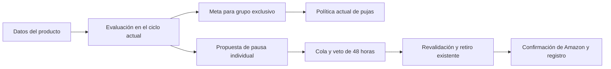

# AUTO-03: decisiones publicitarias por producto

Estado: diseño propuesto, 24 de octubre de 2026, hora de David. No es un plan
entregado al motor ni una política aprobada. Base leída: `origin/master`,
`ce956518`. Las reglas nuevas de este documento son propuestas del autor.

## Resultado para el dueño

Orbit evalúa cada producto por mercado y muestra qué puede hacer con sus anuncios.
Si los datos alcanzan, calcula una meta publicitaria individual para los grupos
que anuncian exclusivamente ese producto. Si un producto acumula gasto sin ninguna
venta atribuida, puede proponer pausar sus anuncios individuales, también dentro
de campañas compartidas. La publicación sigue a la venta.

La decisión vive dentro del ciclo actual. Las pujas siguen saliendo de
`niveles_v3`; las pausas usan la cola, el veto y la confirmación contra Amazon.
No se crea otro motor que compita por cambiar las mismas pujas.

Primera entrega propuesta: Amazon Sponsored Products MX y US. Mercado Libre no
tiene aquí una escritura publicitaria autorizada ni los mismos datos. El reparto
de presupuestos entre campañas sigue en AUTO-05. No se crean campañas ni se
reactivan anuncios automáticamente como consecuencia de esta entrega.

## Lo que existe y los datos comprobados

`app/cycle.py` decide keywords y product targets. Estos últimos son objetivos
publicitarios, no los productos propios anunciados. `app/optimizer/goals.py`
resuelve una sola cascada de metas. `app/retiro_anuncios.py` ya pausa y repone
product ads con intención previa, lectura de confirmación y registro durable.
El impulso ya separa un producto en dos campañas y tiene su propio aprendizaje.

La [lectura de producción](../../evidencia/auto-03/diseno/lectura-2026-10-25.md)
encontró 7 productos MX y 3 US con margen individual positivo publicado. Son un
máximo inicial de cobertura financiera, no diez productos automáticamente
elegibles. El resto conserva el comportamiento actual y muestra el motivo por
el que no recibió una meta individual.

La vista financiera excluye publicidad y usa una ventana desde 2026-02-20 hasta
D-15. El historial Ads por producto almacenado empieza en 2026-08-08. No se puede
calcular hoy una utilidad total después de Ads para toda la ventana financiera
rellenando los meses faltantes con cero.

## Uso desde el ciclo, antes de definir los tipos

Estas llamadas son la API propuesta, no funciones que ya existan.

```python
# TX2: una lectura por lote, bajo el snapshot del ciclo.
entradas = lee_entradas_productos(conn, plataforma, decidido_el, configuracion)
evaluaciones = tuple(resolver_producto(entrada) for entrada in entradas)

# El adaptador del ciclo proyecta las metas solo a grupos exclusivos y
# llama a las dos variantes que ya usa el motor con un goal ya resuelto
# (cascada_target_acos_con_procedencia no es la llamada del motor y su
# argumento cache_acos_target esta muerto: no se cita). target_margen_producto
# va keyword-only, con precedencia despues del goal y antes de la familia.
meta_producto = meta_para_grupo(evaluaciones, alcance_del_grupo)
target = g.cascada_target_acos(
    goal.target_acos_pct,
    setting_target,
    margen_plataforma,
    goal.scope,
    target_margen_familia,
    target_margen_producto=meta_producto,
)
procedencia = g.peldano_target_acos(
    goal.target_acos_pct,
    goal.scope,
    margen_plataforma,
    setting_target,
    target_margen_familia,
    target_margen_producto=meta_producto,
)

# TX3: guardar evaluaciones y decisiones en la misma transaccion.
# Las pausas pasan por apply_cola.encola_cortes, sin otro encolador.
```

La pantalla lee evaluaciones persistidas. No llama al resolutor ni cambia la
política. El replay lee los insumos congelados de la evaluación referida por la
decisión y ejecuta el mismo resolutor puro. No consulta el margen actual.

## Política económica propuesta

El margen individual es una referencia histórica antes de publicidad. Sirve para
proponer una meta de ACoS; no demuestra la utilidad exacta de una venta atribuida
ni garantiza la utilidad futura.

Para margen individual positivo `M` en puntos porcentuales y fracción configurada
`f`, la meta candidata es `min(f * M, MARGEN_BANDA_MAX)`. Se reutilizan el lector
de fracción y el máximo vigentes de `goals.py`; no se copian constantes. En la
consulta actual, las fracciones fueron 0.5 en MX y 0.8 en US y el máximo es 45%.

No se aplica el piso de 10% a este peldaño: margen 8% y fracción 0.5 producen 4%,
no 10%. Ese cambio respecto del margen de plataforma es explícito y se limita al
nuevo peldaño. La política de bids conserva sus límites por cambio, pisos y techos.

La cascada única propuesta es:

```text
goal explícito de campaña o plataforma
  → margen del producto, únicamente en grupo exclusivo y elegible
  → margen de familia → margen de plataforma → setting
```

Un goal explícito conserva su precedencia. La pantalla indica cuando domina sobre
la referencia del producto. Por eso la meta individual no se presenta como un
tope absoluto de protección. No se crean goals de campaña congelados que impidan
que el margen individual se actualice.

El margen conserva las condiciones de su fuente: cobertura por monto de al menos
95%, 30 días con venta, integridad de moneda y cargos, y frescura del ledger bajo
la regla existente. La muestra limitada no se convierte en margen decisorio.
Margen desconocido, cero o negativo no entra como target cero: deja un motivo y
conserva la cascada actual. No significa que el producto sea rentable.

## Atribución y madurez

La evaluación de rendimiento usa una ventana propuesta de 30 fechas:
`[D-60, D-30)` UTC. Colapsa por mercado, ASIN, SKU y fecha a la última observación
disponible al decidir. Cada fecha exige su propia reobservación a partir de
`metric_date + 30 días`; no basta el máximo global de `observed_at`.

Para una meta individual se exige que las ventas atribuidas sean del mismo SKU
en la evidencia que sustenta esa meta. Si hay ventas de otros SKU, no se les
asigna el margen del producto anunciado. Se informa `halo_sin_margen` y se
conserva la política vigente. El dinero se suma por producto y mercado; sus
publicaciones no duplican la economía observada.

El target es una referencia predictiva. Si se usa con la política de hojas de
90 días, la comprobación de identidad y ausencia de halo debe cubrir también
el periodo de evidencia de esas hojas. La ventana corta, por sí sola, no acredita
esa condición. Si no se puede comprobar, esa hoja no recibe el nuevo peldaño.
No se cambia a 30 días la política `niveles_v3` para hacer coincidir ventanas.
Los 77 días de fechas Ads almacenadas al consultar tampoco demuestran cobertura
de 90 días. Por ello, hoy podrían no existir hojas elegibles para la nueva meta,
aunque sí haya diez productos con margen. La implementación debe medirlo.

Una fila ausente se rige por dos supuestos sellados (sección «Supuestos de
construcción»). Para la pausa (S6): una fecha sin fila cuenta como cero
observado solo si una corrida `ingest_run.ok` dejó el reporte de productos de
esa plataforma en `written` con el rango pedido guardado que incluye esa fecha
y `cobertura_integra` verdadera — la ingesta no descartó ninguna fila que
pudiera ser actividad —, esa corrida empezó cuando la fecha ya era madura y el
producto tiene al menos una fila en la ventana; un rango desconocido no cubre
nada, así que las corridas anteriores a esa cobertura no cuentan. Para el halo
de la meta (S7): se mide en `[D-90, max(metric_date)-3]` con la última
observación, sumando solo las fechas con fila — una fecha sin fila no tuvo
clics, así que no puede tener ventas atribuidas que cuenten como halo —; el
tramo de menos de 30 días se acepta sin madurez y con motivo. La pausa exige
madurez +30 en `[D-60, D-30)`. Un periodo anterior al alta demostrada del
anuncio queda fuera de su actividad, sin fabricar observaciones; si no se puede
demostrar el alta o resolver la identidad, el intervalo queda incompleto.

## Acción individual propuesta cuando no hubo ventas

La nueva pausa solo se propone si el total del producto tiene compras atribuidas
igual a cero y ventas atribuidas igual a cero, ambas observadas y maduras, y
cumple el piso de gasto y clics de PAUSE vigente. Para esta propuesta se reutiliza
el fallback de clics y el piso monetario desde sus fuentes, sin inventar una
tasa de conversión por producto. Al diseñar: 100 clics y 500 MXN o 40 USD.
Trasladar esa regla de hoja a producto es una decisión nueva propuesta, no una
autorización heredada. No se usa el umbral 350 MXN/36 USD de aprendizaje como pausa.

Una venta de otro SKU impide afirmar cero ventas. Un dato desconocido también.
Los anuncios de impulsos aún abiertos quedan bajo su vigía, sin doble actuación.
Se excluyen campañas con goal deshabilitado o modo no live para la ejecución.
La pantalla distingue el gasto observado del gasto sobre el que Orbit puede actuar.

La pausa afecta únicamente product ads que contribuyeron a esa evidencia y cuya
identidad, producto, periodo activo y estado actual están comprobados. No alcanza
anuncios recién creados sin esa historia ni anuncios sin vínculo. No promete
detener todo el gasto del producto si hay otros anuncios fuera de ese alcance.

No se añade en esta entrega una pausa económica automática de un producto que sí
vende. En grupos exclusivos, el target individual guía la política actual de bids.
En grupos compartidos, el exceso de gasto queda explicado y puede motivar una
separación mediante las herramientas existentes, pero no crea campañas solo.

## Campañas compartidas, stock e impulso

El alcance se comprueba por ad group y por todos sus product ads no archivados,
incluidos los pausados que pueden volver. Solo es exclusivo si todos tienen
identidad conocida y corresponden al mismo producto y mercado. Compartir una
campaña y presupuesto no implica compartir la puja de cada ad group.

Con dos productos, no se usa el mínimo ni el promedio de sus metas para mover
una palabra compartida. Se conserva el target actual del grupo. Una pausa
individual válida sí puede retirar el anuncio del producto que no vendió sin
pausar el anuncio del otro producto.

Stock desconocido no equivale a cero. La lectura FBA actual no basta como fuente
universal de unidades vendibles. Esta entrega muestra la disponibilidad conocida
y su fuente, pero no cambia anuncios por inventario. Para una política de stock
hay que conciliar primero la autoridad de bridge y la disponibilidad por listing;
no se inventa aquí un endpoint. La falta de stock reconciliado no se convierte
en un nuevo bloqueo general de las decisiones de rendimiento existentes.

Un impulso abierto conserva su aprendizaje. Al graduarse conserva el goal de
campaña con target que trae de fábrica, y como gana cualquier goal con target
no nulo — también el de fábrica y el de impulso —, la hoja no entra por la
evaluación del producto: la frase «al graduarse entra por la misma evaluación»
era falsa contra el código. Lanzar un impulso o agregar un producto a
un grupo invalida la huella de alcance y exige recalcular antes de aplicar una
acción individual pendiente.

## Tipos y límites de módulos

Esquema de tipos propuesto. Todos los importes llevan moneda y usan Decimal.
Las variantes completas se construyen al validar las fuentes, no mediante casts.

```python
from dataclasses import dataclass
from datetime import date, datetime
from decimal import Decimal
from typing import Literal

from app.optimizer import goals  # MedicionMargen vive en goals (app/optimizer/goals.py)

Plataforma = Literal["amazon_mx", "amazon_us"]
Moneda = Literal["MXN", "USD"]


@dataclass(frozen=True)
class Dinero:
    valor: Decimal
    moneda: Moneda


@dataclass(frozen=True)
class Producto:
    plataforma: Plataforma
    product_id: int


@dataclass(frozen=True)
class Ventana:
    desde: date
    hasta_exclusivo: date


@dataclass(frozen=True)
class SinDato:
    motivos: tuple[str, ...]


# El margen medido NO se redefine aqui: es goals.MedicionMargen, el espejo
# puro de la vista de margen que ya existe (margen_neto_pct, cobertura,
# dias_con_venta, venta_cubierta, ledger_fresco_at, moneda, ventana_desde,
# ventana_hasta). Se reutiliza tal cual en EntradaProducto.


@dataclass(frozen=True)
class AdsCompletos:
    ventana: Ventana
    gasto: Dinero
    clics: int
    compras_total: Decimal
    ventas_total: Dinero
    ventas_mismo_sku: Dinero
    referencias_por_fecha: tuple[str, ...]


@dataclass(frozen=True)
class AnuncioElegible:
    ad_entity_id: int
    listing_id: int
    grupo_id: int
    huella_alcance: str


@dataclass(frozen=True)
class GrupoAptoParaMeta:
    grupo_id: int
    ventana_evidencia_hojas: Ventana
    referencias_identidad_y_halo: tuple[str, ...]
    huella_alcance: str


@dataclass(frozen=True)
class EntradaProducto:
    producto: Producto
    decidido_el: datetime
    margen: goals.MedicionMargen | SinDato
    actividad: AdsCompletos | SinDato
    fraccion: Decimal | SinDato
    piso_pausa: Dinero
    clics_pausa: int
    anuncios: tuple[AnuncioElegible, ...]
    grupos_aptos_para_meta: tuple[GrupoAptoParaMeta, ...]
    impedimentos: tuple[str, ...]


@dataclass(frozen=True)
class MetaReferencia:
    porcentaje: Decimal
    grupos_elegibles: tuple[GrupoAptoParaMeta, ...]


@dataclass(frozen=True)
class PropuestaPausa:
    anuncio: AnuncioElegible
    motivo: Literal["producto_sin_ventas"]


@dataclass(frozen=True)
class EvaluacionProducto:
    producto: Producto
    meta: MetaReferencia | SinDato
    pausas: tuple[PropuestaPausa, ...]
    motivos: tuple[str, ...]


def resolver_producto(entrada: EntradaProducto) -> EvaluacionProducto:
    raise NotImplementedError("Boceto de arquitectura; no es codigo ejecutado")
```

`AnuncioElegible` implica exclusiones de impulso, goal, identidad y periodo
comprobadas por el adaptador. El resolutor aún exige la regla económica completa.
`GrupoAptoParaMeta` exige exclusividad, identidad y ausencia de halo comprobadas
para el periodo de las hojas; conserva las referencias que permiten revalidarlas.
Si las hojas del grupo usan periodos distintos, se exige cubrir su unión antes
de construir esa variante. Un grupo exclusivo sin esa evidencia no es apto.

Una pausa pendiente domina sobre nuevas subidas para el mismo anuncio. En un
grupo exclusivo, se omiten nuevas subidas mientras esa pausa siga vigente; en
uno compartido no se altera la puja común por esta pausa individual. Las bajadas
de la política actual conservan su camino. Cancelar la pausa elimina ese efecto
en el ciclo siguiente, sin restaurar una puja histórica automáticamente.

| Módulo | Cambio propuesto |
|---|---|
| `app/optimizer/productos.py`, nuevo | Tipos y función pura anterior. Sin SQL, HTTP ni reloj propio. |
| `app/productos_io.py`, nuevo | Lectura por lote, colapso e identidad. Construye entradas válidas. |
| `app/cycle.py` | Una carga y una resolución antes de recorrer hojas; persistencia junto con decisiones. |
| `app/optimizer/goals.py` | Nuevo argumento con nombre y nuevo peldaño en el núcleo único; migrar todas sus variantes y consumidores en el mismo cambio. |
| `app/apply_cola.py` | Encolar y revalidar la nueva pausa por el camino existente. |
| `app/retiro_anuncios.py` | Único propietario del retiro/reposición; aceptar autorización automática comprobable sin fingir un literal humano. |
| Pantalla de productos | Leer la última evaluación del ciclo terminado, motivos y vínculos a anuncios afectados. |

La lectura oculta SQL y detalles de Amazon. La función pura oculta la política.
No hay un servicio de política, un cron nuevo ni un caché mutable por producto.

## Persistencia y escritura única

Nueva tabla propuesta `evaluacion_producto_ciclo`, append-only, clave
`(cycle_id, platform, product_id)`: versión de política/configuración, entradas
congeladas, referencias de fuentes, resultado y huella de alcance. Se inserta en
TX3 junto con las decisiones. No gobierna el ciclo siguiente.

`decision` referencia esa evaluación inmutable mediante FK. No se copian tres
veces sus insumos en tablas independientes. El replay resuelve esa referencia.
La fuente económica sigue siendo la vista actual; la evaluación es evidencia
histórica de lo que leyó, no una segunda fuente de margen.

La decisión usa el kind existente `pause` sobre la entidad `product_ad`; no se
crea un kind nuevo (`pause_product_ad` encadenaría el enum, los CHECK, los
triggers, el mapa de cuota y los despachos sin beneficio). Con kind `pause` y
entidad `product_ad` pasan el CHECK de coherencia de término, la familia
GENERATED `entity_cut`, la madurez del corte y la cuota de pausas compartida,
con una sola reserva por anuncio. La contraparte es ramificar por entidad en la
cola: modo efectivo (hoy un product_ad cae a shadow), payload de pausa
(`{adId, state}`), revalidación (hoy `entidad_no_viva`), reconciliación y
replay. La ejecución de la pausa corre dentro del ciclo actual, en su fase de
apply (TX4) como el rol `app_decide`, con los grants mínimos sobre el ledger de
retiro y una vista estrecha de impulso; sin cron nuevo ni ejecutor fuera del
ciclo.
Los invariantes de fecha van en trigger con UTC fijado. No se fija todavía el
número de migración, pues otras ramas pueden ocuparlo.

La cola sigue siendo dueña de revalidación, claim y cuota. `retiro_anuncios`
conserva el PUT y la reconciliación. Su intención recibe un `decision_id` único
para el motivo nuevo `producto_sin_ventas`. El intento de apply y la intención
se vinculan antes del HTTP; el cierre de la cola deriva del resultado confirmado
de esa misma intención. No hay una segunda reserva de cuota ni un segundo PUT.

La firma de `ejecuta_retiro` migra sus llamadores en la misma entrega para recibir
`AutorizacionHumana` o `AutorizacionDeDecision`. La segunda se verifica contra la
decisión reclamada, su modo live, veto vencido, alcance y reserva. No se usa una
cadena fija como `go="automatico"` para simular autorización del dueño.

## Aplicación, fallos parciales y reversa



Al decidir se congela el alcance. Antes de aplicar se comprueban de nuevo fuentes,
goal, modo, ventas, topología, estado de Amazon e impulso. Si cambió alguna
premisa relevante, se descarta la acción; un ciclo posterior puede regenerarla.
No se permite aplicar una meta de producto a una hoja que pasó a ser compartida.

Los retiros manuales, de impulso y automáticos usan las mismas llaves
`retiro-ad:<id>`. Una respuesta incierta deja la intención abierta. El reintento
reconcilia esa intención antes de mandar otro cambio. Observar `PAUSED` después
de una respuesta incierta demuestra el estado, no quién lo cambió. Sin evidencia
de autoría, el retiro queda adoptado o incierto y no habilita reposición propia.
Un lote de cinco anuncios
con cuatro confirmados muestra 4/5, nunca “producto pausado” sin matiz.
`ejecuta_retiro` devuelve un resultado por anuncio
(`tuple[ResultadoAnuncio, ...]`) en lugar de lanzar `RuntimeError` con un
conteo en el texto: la cola cierra cada fila desde el resultado de su propia
intención y un fallo parcial no borra lo confirmado.

La reversa se construye antes de encender. Usa los retiros confirmados del propio
AUTO-03, bajo las mismas llaves. No reactiva un anuncio que ya estaba pausado antes
ni uno cuyo cambio fue adoptado sin una escritura propia. La primera entrega ofrece
reposición manual de los IDs concretos. Si Amazon lo archivó por fuera, no lo
recrea silenciosamente: muestra que recuperar ese anuncio necesita una creación
explícita mediante el camino existente. El listing nunca se desactiva.

Hoy `repone` puede recrear anuncios archivados. Su contrato debe distinguir la
reposición de un anuncio existente de la recreación explícita. AUTO-03 usa solo
la primera; el escritor vuelve a comprobar el estado bajo la misma llave y
devuelve `requiere_recreacion` si está archivado, sin POST: `repone` nunca
recrea, y recuperar ese anuncio pasa por la creación explícita con su propia
confirmación. Una autorización para reponer
no habilita por sí sola crear otro anuncio.

Apagar AUTO-03 detiene nuevos efectos de esta política y descarta sus pausas aún
pendientes. Las intenciones ya enviadas se reconcilian; apagar no borra el rastro
ni repone automáticamente anuncios. El motor de pujas sigue su cascada anterior.

## Casos que debe cumplir el constructor

| Caso | Resultado esperado |
|---|---|
| Margen 40%, fracción 0.5, grupo exclusivo, datos válidos | Meta propuesta 20%; si hay goal explícito, gana ese goal. |
| Margen 8%, fracción 0.5 | Meta 4%, sin elevarla a 10%. |
| Dos productos comparten ad group | Ninguno impone su meta individual a la puja compartida. |
| Compras del mismo SKU cero, pero hay una compra de otro SKU | No hay pausa por cero ventas. |
| 100 clics, 500 MXN, cero compras y ventas totales explícitas, periodo completo | Propuesta de pausa para sus anuncios elegibles; no pausa de publicación. |
| Fecha o identidad sin dato | Abstención de la nueva acción, sin completar con cero. |
| Impulso abierto | El vigía conserva la decisión sobre ese aprendizaje. |
| Pausa confirmada, proceso muere antes del cierre de cola | Reconciliar la intención y cerrar sin otro PUT ni otra cuota. |
| Cambió la mezcla de productos antes del apply | Descartar; no ejecutar el target o pausa obsoletos. |

## Verificación y entrega futura

La implementación mueve dinero y escribe en producción: corresponden pruebas
focalizadas de cuentas, alcance y reversa. Antes se corre el SELECT de los datos
reales; una regresión debe fallar contra el código anterior. No se piden mutantes,
pruebas de texto, una batería nueva ni esperar semanas para poder construir.

La primera comprobación operativa es de lectura: reproducir un ciclo histórico
con sus fuentes, mostrar metas/pausas que habría propuesto y conciliar una muestra
contra Amazon. Después se comprueban escritura y reversa conforme a la autorización
vigente. No se llama “encendido” a escribir la propuesta ni a compilar.

Siguiente paso de construcción, una vez elegido este diseño: implementar el
resolutor y su adaptación a la cascada con el caso monetario 8% → 4%, y medir cuántos
productos cumplen realmente identidad, ventana y margen antes de prometer cobertura.

## Decisiones que esta propuesta deja visibles

La recomendación es adoptar la estructura integrada y la referencia individual
derivada del margen. Mantener la precedencia de los goals explícitos es una elección
de este diseño. La nueva pausa por cero ventas y el uso de los pisos actuales en
el grano producto requieren el sello de esa política antes de ejecutar efectos.
Los números no se presentan como decisiones nuevas ya tomadas por David.

Este diseño cubre una primera entrega de AUTO-03. Quedan fuera de ella la pausa
económica automática de productos con ventas en grupos compartidos, las decisiones
de inventario sin fuente conciliada y la reactivación automática. No se debe marcar
AUTO-03 completo atribuyéndole esas capacidades.

## Supuestos de construcción

Supuestos fijados por el plan decisiones-producto-01 (copiados del plan; el
número entre paréntesis remite al gotcha correspondiente de
`docs/evidencia/auto-03/plan/ground/00-explicacion.md`):

| S | Supuesto fijado (gotcha) | Cómo se revierte |
| --- | --- | --- |
| S1 | Gana el goal con target no nulo, también el de fábrica e impulso (g3). Medido el 2026-11-05 en solo lectura: ningún goal tiene target, así que hoy S1 no deja fuera ninguna hoja; solo aplica si alguien pone uno. A.3 lo vuelve a medir. | `limpia_target` del goal de campaña en /settings pasa ese grupo al peldaño producto. |
| S2 | Meta = min(fracción × margen, 45), sin piso de 10. ORBIT 07 M2: la meta calculada se aplica DIRECTA desde el primer ciclo elegible y en cada cambio posterior del margen (excepción explícita a la rampa de 0.5 puntos; los pasos de cambio de puja no cambian). Si el producto pierde elegibilidad, la hoja resuelve la cascada completa de respaldo en ese ciclo y el target individual no se interpola hacia otra economía. | Interruptor meta en `off` o `shadow` restaura la cascada previa sin borrar evaluaciones. |
| S3 | R3 sigue comparando con el equilibrio de plataforma (g6). | Plan aparte: equilibrio por hoja. |
| S4 | Alcance de la pausa: product ads ENABLED del producto, con identidad, goal live, fuera de impulso abierto, `first_seen_at` anterior a la ventana y cuyo adId aparece en `ad_ids` de la ventana. Es pertenencia, nunca reparto (g8). Si `ad_ids` no es una lista de ids, el alcance es "todos los ENABLED con identidad" y A.3 lo dice. | Interruptor pausa en `off`. |
| S5 | La fila Ads se liga al producto por ASIN (`listing`) y se exige `advertised_sku = listing.seller_sku`; otro SKU con gasto es impedimento `sku_distinto_en_asin`. "Mismo SKU" usa los campos de Amazon tal cual; cualquier otra venta cuenta como halo (g9). | Constante en `productos.py`. |
| S6 | Una fecha sin fila cuenta como cero observado solo si una corrida `ingest_run.ok` dejó el reporte de productos de esa plataforma en `written` con un rango pedido guardado que incluye esa fecha y `cobertura_integra` verdadera (D.7: la ingesta no descartó ninguna fila que pudiera ser actividad), esa corrida empezó cuando la fecha ya era madura y el producto tiene al menos una fila en la ventana. Un rango desconocido no cubre nada: las corridas anteriores a D.7 no cuentan, así que la pausa empieza a poder actuar unos 30 días después de desplegar D. Si no, la fecha es desconocida (g10, corrige la spec). S6 solo aplica a la pausa. | Constante en `productos_io.py`, congelada como `politica` en cada evaluación. |
| S7 | Halo de la meta en `[D-90, max(metric_date)-3]` con la última observación, sumando solo las fechas con fila: una fecha sin fila no tuvo clics, así que no puede tener ventas atribuidas que cuenten como halo. El tramo de menos de 30 días se acepta sin madurez y con motivo. La pausa exige madurez +30 en `[D-60, D-30)` (g11, corrige la spec). | Constante en `productos.py`. |
| S8 | Límites de la pausa editables por mercado (C.7): clics mínimos y gasto mínimo en la moneda del mercado. Por omisión, para la práctica y la simulación, `cortes.F_PAUSE` (100) y `bid.PAUSE_COST_MIN` (500 MXN / 40 USD); nunca por debajo de `cortes.LEGACY_NEGATIVE` (20 clics) ni de `cortes.NEGATIVE_COST_MIN` (130 MXN / 8 USD). No el umbral adaptativo (g13). Cada evaluación congela los límites con que se calculó. La simulación de H.8 muestra su efecto; mientras falte cobertura de D.7 lo marca `sin_cobertura_d7`. Decidido por David el 2026-11-05: la pausa queda en práctica hasta que él guarde sus límites y la encienda desde la pantalla (I.8). `config_write.proxima_config` rechaza la pausa en `live` con `SettingsInvalido` si falta alguna de las dos claves de límites, así que nunca se enciende con los valores por omisión, ni por el CLI ni por el botón. Ningún bloque pone la pausa en `live` en `interruptores.env`. | Botón "Volver a práctica" (I.8) o `productos-modo --pausa shadow`; interruptor pausa en `off`. |
| S9 | Este plan sella que la cola admita `pause` sobre `product_ad` (g15). Aprobado por David el 2026-11-05. | Interruptor pausa en `off`; la cola descarta las pendientes con `modo_no_live`. |
| S10 | El ciclo ejecuta la pausa en TX4 como `app_decide`, con grants mínimos sobre el ledger de retiro y una vista estrecha de impulso. Sin cron ni ejecutor nuevos (g16). Aprobado por David el 2026-11-05. | Reversa de la 0080. |
| S11 | Kind `pause` sobre la entidad `product_ad`, no `pause_product_ad` (g14, corrige la spec). | - |
| S12 | La revalidación de pausas de hoja lee frescos goals y margen de plataforma. ORBIT 07 M2: una decisión con procedencia `margen_producto` se revalida con la evaluación fresca del ciclo ejecutor y el mismo resolutor (goal, identidad, atribución, moneda y respaldo); si el grupo cambió o el producto perdió elegibilidad, no usa la meta individual congelada y resuelve el respaldo completo (familia fresca + plataforma/setting). La meta puede cambiar por insumos nuevos; los inputs históricos de la decisión no se reescriben. | Selección de la versión anterior: `off`/`shadow` en `ads_producto_meta_<plat>`. |
| S13 | El literal guardado del vigía cuenta como `AutorizacionHumana` de origen impulso (g20). Aprobado por David el 2026-11-05. | Plan aparte. |
| S14 | Confirmar después de una respuesta incierta sella `autoria='adoptada'` para cualquier motivo; `repone` excluye adoptados salvo que una `AutorizacionHumana` pida `incluye_adoptados`; una `AutorizacionDeDecision` nunca repone adoptados (g22). Aprobado por David el 2026-11-05. | Reversa de la 0078. |
| S15 | `repone` nunca recrea; recrear pasa por `/retiro/recrear` con su propia confirmación (g23). | - |
| S16 | La meta solo aplica a hojas (bids y pausas de hoja); los cortes de término de `_procesa_grupo` conservan su cascada (alcance). | - |
| S17 | Un product ad que regresaste tiene 7 días de gracia: Orbit no lo vuelve a proponer ni a pausar en ese plazo, como las keywords (`docs/APPLY.md` §3.3). La gracia corre desde `anuncio_reposicion.repuesto_el`; si lo reactivaste directo en Amazon, el primer ciclo que lo ve ENABLED cierra su retiro con `actor='reactivacion_manual_amazon'` (H.7) y la gracia corre desde ese ciclo. Aprobado por David el 2026-11-05. | Constante en `productos.py`. |
| S18 | Encender la pausa en vivo cierra en bloque las propuestas de práctica abiertas de product ads de esa plataforma, como el cambio a vivo de ORBIT 05 (`docs/APPLY.md` §12 ítem 4); sin eso, una fila de práctica tapa la clave del anuncio para siempre. | - |
